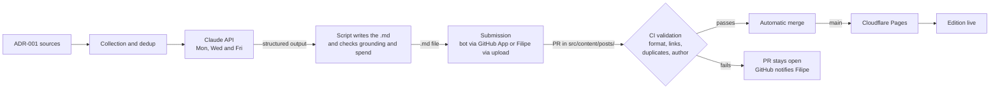

# Architecture overview

PedsLetter's **planned** architecture, from the final plan approved on 2026-11-15. Nothing here is implemented: the repository holds only docs and a skeleton. Each part takes effect once its issue is verified, and this document is updated with what actually exists.

Decisions: [ADR-0001](../decisions/0001-curation-sources.md) (sources), [ADR-0002](../decisions/0002-publishing-without-review-or-indexing.md) (no review, no indexing), [ADR-0003](../decisions/0003-publishing-format-and-path.md) (publishing format and path) and [ADR-0004](../decisions/0004-generation-by-claude-api.md) (generation by the Claude API).

## Components

| Component | Choice | Role | Issue |
| --- | --- | --- | --- |
| Site | Astro + Markdown, strict TypeScript | Builds static HTML; a `.md` file in the folder is already an edition | F1-01, F1-04 |
| Hosting | Cloudflare Pages | Publishes `main`; builds a preview per branch | F1-02 |
| Repository and CI | Public GitHub, GitHub Actions | Build, tests, content validation and automatic merge | F1-01, F2-05 |
| Collection | GitHub Actions script | Fetches candidates from the ADR-001 sources and drops those already seen | F2-11 |
| Generation | Claude API (Sonnet 5.5), called by a GitHub Actions script | Triages the candidates and writes the summaries as structured output, Monday, Wednesday and Friday mornings; up to US$30 a month | F2-12, F2-14, F3-01 |
| Bot | GitHub App installed only on this repository | Opens the edition PR with a token created on each run | F2-10 |
| Analytics | Cloudflare Web Analytics | Visit counts, no cookies | F1-09 |
| Domain | `pedsletter.com.br` | Final address; until phase 4 the site lives on `*.pages.dev` | F4-01, F4-02 |

Astro was chosen over Hugo or Eleventy because TypeScript calculators with tests are simpler there, and over a hosted blog because that would have neither calculators nor file validation.

## Planned directory layout

```
src/config/site.ts    site URL and indexing switch
src/content/posts/    one .md file per edition
src/components/       AI notice, article list, <Calculator>
src/pages/            home, edition, tags, about, notice, privacy, RSS
src/calc/<id>/        calculator definition and cases.json (phase 5 on)
src/data/who/         script-generated LMS tables (phase 6)
scripts/              format, link, duplicate and grounding validation
pipeline/             collector, generator, prompt and sources configuration (phase 2)
docs/decisions/       recorded decisions
.github/workflows/    CI and automatic merge
```

Directories are created in the phase that uses them. The plan called for `docs/adr/`; the repository uses `docs/decisions/`.

## Content pipeline



| Step | Who | Output |
| --- | --- | --- |
| 1. Collection | Script, without the model | Candidates with URL, DOI, date and accessible text |
| 2. Generation | Claude API, called by the script | Structured output, turned into a `.md` file and checked (numbers and links grounded in the source, spend cap) |
| 3. Submission | Bot via the GitHub App, or Filipe via "Upload files" | PR with the file in `src/content/posts/` |
| 4. Validation | CI | Format, links, duplicates and PR author checked |
| 5. Merge | Workflow, when validation passes | File on `main` |
| 6. Publishing | Cloudflare Pages | Edition live |
| 7. Failure | GitHub notifies Filipe; a generation workflow failure opens an issue (F2-15) | An open PR or no PR, nothing published |

The model has no tool that writes to the repository; fetched text is treated as data. If generation fails, Filipe can upload a file by hand at step 3 and nothing else changes.

### Edition format

Markdown with YAML frontmatter, one file per edition, named `YYYY-MM-DD-resumo.md`. Field names, values and the sample text stay in Portuguese: they are identifiers and site content.

```markdown
---
titulo: "Resumo de 16/11/2026"
data: 2026-11-16
resumo: "Uma frase sobre a edição."
tags: [neonatologia, infectologia]
status: publicado         # publicado | retirado
motivoRetirada:           # required when retirado
artigos:
  - titulo: "Título original do artigo"
    fonte: "Nome do periódico ou entidade"
    url: "https://doi.org/..."
    publicadoEm: 2026-11-10
    tipo: "ensaio clínico randomizado"
    categoria: artigo          # artigo | diretriz | alerta | noticia
    acesso: "texto completo"   # or "apenas resumo"
---

## Título original do artigo

**Por que importa:** ...
**O que foi feito:** ...
**Resultado:** ...
**Limitações:** ...
```

It is not MDX because a stray `<` or `{` in AI-generated text breaks the build.

### Validation outside the build

Format, link and duplicate checks run on the PR. Only valid files reach `main`, so a bad file does not block later deploys.

| Check | Rule | Issue |
| --- | --- | --- |
| Schema | Required fields; `motivoRetirada` required when `status: retirado` | F2-01 |
| Links | Every URL responds and every DOI resolves | F2-03 |
| Duplicates | An already published URL raises a warning; a URL from a withdrawn edition fails validation | F2-04 |
| Authorship | Block-list terms fail CI, in the PR text too | F1-06 |
| Grounding | Every URL came from the run's collection or search, from an ADR-001 source; every number in the summary appears in the source text | F2-13 |

### Automatic merge

The repository is public, so anyone can open a PR. The workflow merges only when every condition holds (F2-05):

- the author is on the allow list (Filipe or the project's GitHub App);
- the PR comes from a branch of this repository, not a fork;
- the PR only adds files under `src/content/posts/`;
- validation passed.

On a PR from a fork or from an author outside the list, the workflow uses no secret. The App token is created on each run, lasts one hour and grants access only to this repository's contents and pull requests.

### Withdrawal

| Method | When to use it | Effect |
| --- | --- | --- |
| `status: retirado` (default) | An edition with an error or poor content | It disappears from the home page, the tags and the RSS; the URL shows "edição retirada" and the reason; its articles go onto the bot's block list |
| Delete the file | Content that must not stay visible on the site | The URL returns 404 |
| Revert the deploy in Cloudflare Pages | Emergency | Back to the previous version in seconds, without touching the repository |

Withdrawn or deleted text stays in the Git history.

## Indexing

- `src/config/site.ts` has an `indexavel` switch, off.
- With it off, every page carries `noindex` in the meta tag and in the `X-Robots-Tag` HTTP header, and the site builds no sitemap.
- `robots.txt` has no `Disallow`: a crawler blocked by `robots.txt` never gets to read the `noindex`.
- A test walks every page of the build and fails if any lacks `noindex` (F1-03).
- The switch is turned on only in F9-04.

## No authorship

No component, page, metadata or repository file names a professional or states a registration or training. Two notices are fixed:

- On every edition, on the home page and in the README: "Curadoria e resumos gerados por IA, sem revisão por profissional de saúde. Confira sempre a fonte original."
- On every page: "Conteúdo destinado a médicos e demais profissionais de saúde."

## Calculators (phase 5 on)

Each calculator is a definition in `src/calc/<id>/` with a `cases.json`, rendered by the `<Calculator>` component. It is the only part of the site with JavaScript in the browser.

| Aspect | Rule |
| --- | --- |
| Inputs | Unit always visible, no silent conversion; decimal comma accepted; age by date of birth or with an explicit unit; drug concentration never prefilled |
| Hard limit | Blocks the result (weight of 0 or above 150 kg, age outside the table) |
| Plausibility | Warns and asks for confirmation (weight-for-age z-score beyond ±5) |
| Output | Step-by-step math and documented rounding; invalid input yields no partial result |
| Verification | `cases.json` with cases from a published source and the reference noted; comparison with the WHO `anthro` package on about a thousand random cases |
| Badge | "Não validada clinicamente" (not clinically validated) on every calculator, until phase 9 |
| Suspension | `status: suspensa` disables the form and shows a notice |
| Privacy | The math runs in the browser; no network request, nothing in the URL or in local storage (F5-05) |

Drug calculators come only in phase 9. The full catalog is in [`docs/project-genesis.md`](../project-genesis.md).

## Budgets

| Area | Rule |
| --- | --- |
| Privacy | No personal data collected: no sign-up, form, comment or e-mail; cookieless analytics |
| Accessibility | WCAG 2.2 AA: 4.5:1 contrast, keyboard use, 44 px touch targets. In the calculators: labels, errors via `aria-describedby`, result in `aria-live` and `inputmode="decimal"` |
| Performance | Zero JavaScript outside the calculators; 30 kB gzip per island; system fonts; Lighthouse CI blocking merge below 95, except for the SEO category |
| Cost | Only the Claude API, up to US$30 a month, until the domain is bought (ADR-004) |
