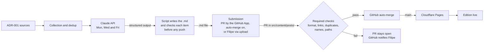

# Architecture overview

PedsLetter's **planned** architecture, from the final plan approved on 2026-11-15 and the plan review of 2026-11-26 ([`docs/plan-review-2026-11-26.md`](../plan-review-2026-11-26.md)). Nothing here is implemented: the repository holds only docs and a skeleton. Each part takes effect once its issue is verified, and this document is updated with what actually exists.

Decisions: [ADR-0001](../decisions/0001-curation-sources.md) (sources), [ADR-0002](../decisions/0002-publishing-without-review-or-indexing.md) (no review, no indexing), [ADR-0003](../decisions/0003-publishing-format-and-path.md) (publishing format and path) and [ADR-0004](../decisions/0004-generation-by-claude-api.md) (generation by the Claude API). Accounts, repository settings and free-plan limits: [`docs/accounts.md`](../accounts.md).

## Components

| Component | Choice | Role | Issue |
| --- | --- | --- | --- |
| Site | Astro + Markdown, strict TypeScript | Builds static HTML; a `.md` file in the folder is already an edition | F1-01, F1-04 |
| Hosting | Cloudflare Pages | Publishes `main`; builds a preview per branch | F1-01 |
| Repository and CI | Public GitHub, GitHub Actions | Build, tests and content validation. The `main` ruleset requires a PR and names the checks that GitHub's auto-merge waits for | F0-01, F1-01, F2-05 |
| Collection | Python script in GitHub Actions | Fetches candidates from the ADR-001 sources and drops those already seen | F2-11 |
| Generation | Claude API (Sonnet 5.5), called by the same script | Triages the candidates and writes the summaries as structured output, Monday, Wednesday and Friday mornings; up to US$30 a month | F2-12, F2-09 |
| Pre-push gate | Python, in the generation job | Checks each item before any push and drops the ones that fail | F2-13 |
| Bot | GitHub App installed only on this repository | Opens the edition PR with a token created on each run and turns on auto-merge | F2-05 |
| Domain | `pedsletter.com.br` | Final address; until phase 9 the site lives on `*.pages.dev` | F4-01, F4-02 |

Astro was chosen over Hugo or Eleventy because TypeScript calculators with tests are simpler there, and over a hosted blog because that would have neither calculators nor file validation. The pipeline is Python because the F0-08 trial code is Python and tested, and the site toolchain validates the file anyway (ADR-004).

## Planned directory layout

```
src/config/site.ts    site URL and indexing switch
src/content/posts/    one .md file per edition
src/components/       AI notice, article list, <Calculator>
src/pages/            home, edition, tags, about, notice, privacy, RSS
src/calc/<id>/        calculator definition and cases.json (phase 5 on)
src/data/who/         script-generated LMS tables (phase 6)
scripts/              format, link, duplicate and grounding validation
pipeline/             collector, generator, prompt and sources configuration (Python, phase 2)
docs/decisions/       recorded decisions
.github/workflows/    CI and the generation job
```

Directories are created in the phase that uses them. The plan called for `docs/adr/`; the repository uses `docs/decisions/`.

## Content pipeline



| Step | Who | Output |
| --- | --- | --- |
| 1. Collection | Script, without the model | Candidates with URL, DOI, date and accessible text |
| 2. Generation | Claude API, called by the script | Structured output, turned into a `.md` file within the spend cap |
| 3. Pre-push gate | Script, without the model | Each item checked (links, numbers, dose, names); failing items dropped and named; under the minimum, no edition (F2-13) |
| 4. Submission | Bot via the GitHub App, or Filipe via "Upload files" | PR with the file in `src/content/posts/`; the job turns on auto-merge for its own PRs |
| 5. Validation | CI, as the ruleset's required checks | Format, links, duplicates and names checked again; an App PR outside `src/content/posts/` fails |
| 6. Merge | GitHub's auto-merge, once every required check passes | File on `main`. Filipe merges his own uploads, and every edition until F2-05 (waiver W1) |
| 7. Publishing | Cloudflare Pages | Edition live |
| 8. Failure | GitHub notifies Filipe (F2-09 tests that the notice arrives) | An open PR or no PR, nothing published |

The model has no tool that writes to the repository; fetched text is treated as data. If generation fails, Filipe can upload a file by hand at step 4 and nothing else changes.

### Edition format

Markdown with YAML frontmatter, one file per edition, named `YYYY-MM-DD-resumo.md`. Field names, values and the sample text stay in Portuguese: they are identifiers and site content.

```markdown
---
titulo: "Resumo de 16/11/2026"
data: 2026-11-16
resumo: "Uma frase sobre a edição."
tags: [neonatologia, infectologia]
status: publicado         # publicado | retirado
motivoRetirada:           # required when retirado
artigos:
  - titulo: "Título original do artigo"
    fonte: "Nome do periódico ou entidade"
    url: "https://doi.org/..."
    publicadoEm: 2026-11-10
    tipo: "ensaio clínico randomizado"
    categoria: artigo          # artigo | diretriz | alerta | noticia
    acesso: "texto completo"   # or "apenas resumo"
---

## Título original do artigo

**Por que importa:** ...
**O que foi feito:** ...
**Resultado:** ...
**Limitações:** ...
```

It is not MDX because a stray `<` or `{` in AI-generated text breaks the build.

### Checks before the push and on the PR

The generation job checks each item before any push (F2-13), and the format, link and duplicate checks run again on the PR as required checks. Only valid files reach `main`, so a bad file does not block later deploys.

| Check | Rule | Issue |
| --- | --- | --- |
| Schema | Required fields; `motivoRetirada` required when `status: retirado`; every `url` is `https://` on an ADR-001 host | F2-01 |
| Links | The DOI is registered at doi.org, the PMID resolves, an allow-listed tier 2 page responds; one retry | F2-13 |
| Duplicates | An already published URL raises a warning; a URL from a withdrawn edition fails validation | F2-11 |
| Authorship | Block-list terms fail CI, in the PR text too; the generation job runs the same check before any push | F1-06 |
| Grounding | Every URL and title match a candidate or search result of the same run, from an ADR-001 source; every number in a tier 1 summary appears in the abstract or fetched text; tier 2 items carry no numbers except dates | F2-13 |
| Dose | A dose screen on every field; a dose not attributed to the article drops the item; the site marks each dose with "confira no artigo" | F2-13, F1-04 |

### Auto-merge

The repository is public, so anyone can open a PR. Only the App's PRs merge by themselves (F2-05):

- the generation job opens the PR with the App token and turns on GitHub's auto-merge;
- GitHub merges once every required check in the `main` ruleset passes: validation, the F1-06 names check, and a path check that fails an App PR touching anything outside `src/content/posts/`;
- a PR with a skipped or missing check does not merge;
- a PR from a fork cannot turn on auto-merge, and the validation workflows run on `pull_request`, so it gets no secret. No workflow runs on `pull_request_target`.

The App token is created on each run, lasts one hour and grants access only to this repository's contents and pull requests. The App's private key is a secret only the generation job can read. Until F2-05 exists, Filipe merges each edition after CI (waiver W1 in `DECISIONS.md`).

### Withdrawal

| Method | When to use it | Effect |
| --- | --- | --- |
| `status: retirado` (default) | An edition with an error or poor content | It disappears from the home page, the tags and the RSS; the URL shows "edição retirada", the date and the reason, without the content (F2-07); its URLs go onto the bot's block list, and validation fails a file that reuses one (F2-11) |
| Delete the file | Content that must not stay visible on the site | The URL returns 404 |
| Revert the deploy in Cloudflare Pages | Emergency | Back to the previous version in seconds, without touching the repository |

Withdrawn or deleted text stays in the Git history.

## Indexing

- `src/config/site.ts` has an `indexavel` switch, off.
- With it off, every page carries `noindex` in the meta tag and in the `X-Robots-Tag` HTTP header, and the site builds no sitemap.
- `robots.txt` has no `Disallow`: a crawler blocked by `robots.txt` never gets to read the `noindex`.
- A test walks every page of the build and fails if any lacks `noindex` (F1-03).
- The switch is turned on only in F9-04.

## No authorship

No component, page, metadata or repository file names a professional or states a registration or training. Two notices are fixed:

- On every edition, on the home page and in the README: "Curadoria e resumos gerados por IA, sem revisão por profissional de saúde. Confira sempre a fonte original."
- On every page: "Conteúdo destinado a médicos e demais profissionais de saúde."

## Calculators (phase 5 on, after gate G3)

Each calculator is a definition in `src/calc/<id>/` with a `cases.json`, rendered by the `<Calculator>` component. It is the only part of the site with JavaScript in the browser.

| Aspect | Rule |
| --- | --- |
| Inputs | Unit always visible, no silent conversion; decimal comma accepted; an ambiguous separator ("3.450") is an error; age by date of birth or with an explicit unit; drug concentration never prefilled |
| Hard limit | Blocks the result (weight of 0 or above 150 kg, age outside the table) |
| Plausibility | Warns and asks for confirmation (weight-for-age z-score beyond ±5) |
| Output | Step-by-step math and documented rounding; each value echoed with its unit; invalid input yields no partial result |
| Verification | `cases.json` with cases from a published source and the reference noted; comparison with the WHO `anthro` package on about a thousand random cases |
| Badge | "Não validada clinicamente" (not clinically validated) on every calculator, until phase 9 |
| Suspension | `status: suspensa` disables the form and shows a notice |
| Privacy | The math runs in the browser; no network request, nothing in the URL or in local storage; `connect-src 'none'` on calculator pages (F5-05) |

Drug calculators come only in phase 9, and so does the generic weight-based dose calculator (F6-02). The full catalog is in [`docs/project-genesis.md`](../project-genesis.md).

## Budgets

| Area | Rule |
| --- | --- |
| Privacy | No personal data collected: no sign-up, form, comment or e-mail; no analytics for now |
| Accessibility | WCAG 2.2 AA: 4.5:1 contrast, keyboard use, 44 px touch targets. In the calculators: labels, errors via `aria-describedby`, result in `aria-live` and `inputmode="decimal"` |
| Performance | Zero JavaScript outside the calculators, checked by the page walker (F1-03) and a `script-src 'none'` policy; 30 kB gzip per island; system fonts; from phase 5, Lighthouse CI blocks merge below 95, except for the SEO category (F3-04) |
| Cost | Only the Claude API, up to US$30 a month for every run, split between scheduled runs, development and eval runs and a reserve, until the domain is bought in phase 9 (ADR-004) |
