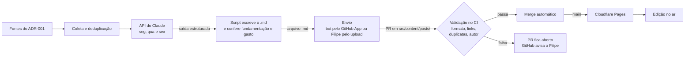

# Visão geral da arquitetura

Arquitetura **planejada** do PedsLetter, a partir do plano final aprovado em 2026-11-15. Nada aqui está implementado: o repositório tem só documentação e esqueleto. Cada parte passa a valer quando a issue correspondente for verificada, e este documento é atualizado com o que existir de fato.

Decisões: [ADR-0001](../decisions/0001-fontes-de-curadoria.md) (fontes), [ADR-0002](../decisions/0002-publicacao-sem-revisao-e-sem-indexacao.md) (sem revisão, sem indexação), [ADR-0003](../decisions/0003-formato-e-caminho-de-publicacao.md) (formato e caminho de publicação) e [ADR-0004](../decisions/0004-generation-by-claude-api.md) (geração pela API do Claude).

## Componentes

| Componente | Escolha | Papel | Issue |
| --- | --- | --- | --- |
| Site | Astro + Markdown, TypeScript estrito | Gera HTML estático; um arquivo `.md` na pasta já é uma edição | F1-01, F1-04 |
| Hospedagem | Cloudflare Pages | Publica a `main`; gera preview por branch | F1-02 |
| Repositório e CI | GitHub público, GitHub Actions | Build, testes, validação de conteúdo e merge automático | F1-01, F2-05 |
| Coleta | Script no GitHub Actions | Busca candidatos nas fontes do ADR-001 e descarta os já vistos | F2-11 |
| Geração | API do Claude (Sonnet 5.5), chamada por script no GitHub Actions | Tria os candidatos e escreve os resumos em saída estruturada, segunda, quarta e sexta de manhã; até US$ 30 por mês | F2-12, F2-14, F3-01 |
| Bot | GitHub App instalado só neste repositório | Abre o PR da edição com token gerado a cada execução | F2-10 |
| Analytics | Cloudflare Web Analytics | Contagem de acessos, sem cookies | F1-09 |
| Domínio | `pedsletter.com.br` | Endereço final; até a fase 4 o site fica em `*.pages.dev` | F4-01, F4-02 |

Astro foi escolhido em vez de Hugo ou Eleventy porque as calculadoras em TypeScript com testes ficam mais simples, e em vez de um blog hospedado porque esse não teria calculadoras nem validação do arquivo.

## Estrutura de diretórios prevista

```
src/config/site.ts    URL do site e chave de indexação
src/content/posts/    um arquivo .md por edição
src/components/       aviso de IA, lista de artigos, <Calculator>
src/pages/            home, edição, tags, sobre, aviso, privacidade, RSS
src/calc/<id>/        definição da calculadora e cases.json (fase 5 em diante)
src/data/who/         tabelas LMS geradas por script (fase 6)
scripts/              validação de formato, links, duplicatas e fundamentação
pipeline/             coleta, gerador, prompt e configuração das fontes (fase 2)
docs/decisions/       decisões registradas
.github/workflows/    CI e merge automático
```

Os diretórios são criados na fase que os usa. O plano previa `docs/adr/`; o repositório usa `docs/decisions/`.

## Pipeline de conteúdo



| Etapa | Quem | Saída |
| --- | --- | --- |
| 1. Coleta | Script, sem o modelo | Candidatos com URL, DOI, data e texto acessível |
| 2. Geração | API do Claude, chamada pelo script | Saída estruturada, convertida em arquivo `.md` e conferida (números e links fundamentados na fonte, teto de gasto) |
| 3. Envio | Bot pelo GitHub App, ou Filipe pelo "Upload files" | PR com o arquivo em `src/content/posts/` |
| 4. Validação | CI | Formato, links, duplicatas e autor do PR conferidos |
| 5. Merge | Workflow, quando a validação passa | Arquivo na `main` |
| 6. Publicação | Cloudflare Pages | Edição no ar |
| 7. Falha | GitHub avisa o Filipe; falha do workflow de geração abre issue (F2-15) | PR aberto ou nenhum PR, nada publicado |

O modelo não tem ferramenta que escreva no repositório; o texto buscado é tratado como dado. Se a geração falhar, o Filipe pode subir um arquivo à mão na etapa 3 e o resto não muda.

### Formato da edição

Markdown com frontmatter YAML, um arquivo por edição, com nome `AAAA-MM-DD-resumo.md`.

```markdown
---
titulo: "Resumo de 16/11/2026"
data: 2026-11-16
resumo: "Uma frase sobre a edição."
tags: [neonatologia, infectologia]
status: publicado         # publicado | retirado
motivoRetirada:           # obrigatório se retirado
artigos:
  - titulo: "Título original do artigo"
    fonte: "Nome do periódico ou entidade"
    url: "https://doi.org/..."
    publicadoEm: 2026-11-10
    tipo: "ensaio clínico randomizado"
    categoria: artigo          # artigo | diretriz | alerta | noticia
    acesso: "texto completo"   # ou "apenas resumo"
---

## Título original do artigo

**Por que importa:** ...
**O que foi feito:** ...
**Resultado:** ...
**Limitações:** ...
```

Não é MDX porque um `<` ou `{` solto em texto gerado por IA quebra o build.

### Validação fora do build

Formato, links e duplicatas rodam no PR. Na `main` só entra arquivo válido, então um arquivo ruim não trava os deploys seguintes.

| Verificação | Regra | Issue |
| --- | --- | --- |
| Schema | Campos obrigatórios; `motivoRetirada` exigido se `status: retirado` | F2-01 |
| Links | Cada URL responde e cada DOI resolve | F2-03 |
| Duplicatas | URL já publicada gera aviso; URL de edição retirada faz a validação falhar | F2-04 |
| Autoria | Termos da lista de bloqueio fazem o CI falhar, também no texto do PR | F1-06 |
| Fundamentação | Todo URL veio da coleta ou da busca da execução, de fonte do ADR-001; todo número do resumo aparece no texto da fonte | F2-13 |

### Merge automático

O repositório é público, então qualquer pessoa abre PR. O workflow só faz o merge quando todas as condições valem (F2-05):

- o autor está na lista permitida (Filipe ou o GitHub App do projeto);
- o PR vem de branch do próprio repositório, não de fork;
- o PR só adiciona arquivos em `src/content/posts/`;
- a validação passou.

Em PR de fork ou de autor fora da lista, o workflow não usa nenhum segredo. O token do App é gerado a cada execução, vale uma hora e dá acesso só a conteúdo e a pull requests deste repositório.

### Retirada

| Forma | Quando usar | Efeito |
| --- | --- | --- |
| `status: retirado` (padrão) | Edição com erro ou conteúdo ruim | Some da home, das tags e do RSS; a URL mostra "edição retirada" e o motivo; os artigos entram na lista de bloqueio do bot |
| Apagar o arquivo | Conteúdo que não deve continuar visível no site | A URL passa a dar 404 |
| Reverter o deploy no Cloudflare Pages | Emergência | Volta à versão anterior em segundos, sem mexer no repositório |

O texto retirado ou apagado continua no histórico do Git.

## Indexação

- `src/config/site.ts` tem uma chave `indexavel`, desligada.
- Com ela desligada, toda página leva `noindex` na meta tag e no cabeçalho HTTP `X-Robots-Tag`, e o site não gera sitemap.
- O `robots.txt` não tem `Disallow`: um buscador bloqueado pelo `robots.txt` não chega a ler o `noindex`.
- Um teste percorre todas as páginas do build e falha se alguma não tiver `noindex` (F1-03).
- A chave só é ligada em F9-04.

## Sem autoria

Nenhum componente, página, metadado ou arquivo do repositório cita nome, registro ou formação de profissional. Dois avisos são fixos:

- Em toda edição, na home e no README: "Curadoria e resumos gerados por IA, sem revisão por profissional de saúde. Confira sempre a fonte original."
- Em toda página: "Conteúdo destinado a médicos e demais profissionais de saúde."

## Calculadoras (fase 5 em diante)

Cada calculadora é uma definição em `src/calc/<id>/` com um `cases.json`, renderizada pelo componente `<Calculator>`. É a única parte do site com JavaScript no navegador.

| Aspecto | Regra |
| --- | --- |
| Entradas | Unidade sempre visível, sem conversão silenciosa; vírgula decimal aceita; idade por data de nascimento ou com unidade explícita; concentração do medicamento nunca preenchida por padrão |
| Limite rígido | Bloqueia o resultado (peso de 0 ou acima de 150 kg, idade fora da tabela) |
| Plausibilidade | Alerta e pede confirmação (peso para a idade com z-score além de ±5) |
| Saída | Conta passo a passo e arredondamento documentado; entrada inválida não gera resultado parcial |
| Verificação | `cases.json` com casos de fonte publicada e a referência anotada; comparação com o pacote `anthro` da OMS em cerca de mil casos aleatórios |
| Selo | "Não validada clinicamente" em toda calculadora, até a fase 9 |
| Suspensão | `status: suspensa` desativa o formulário e mostra aviso |
| Privacidade | O cálculo roda no navegador; nenhuma requisição de rede, nada na URL nem em armazenamento local (F5-05) |

Calculadoras com fármaco só entram na fase 9. O catálogo completo está em [`docs/project-genesis.md`](../project-genesis.md).

## Orçamentos

| Área | Regra |
| --- | --- |
| Privacidade | Nenhum dado pessoal coletado: sem cadastro, formulário, comentário ou e-mail; analytics sem cookies |
| Acessibilidade | WCAG 2.2 AA: contraste de 4,5:1, uso por teclado, alvos de toque de 44 px. Nas calculadoras: rótulos, erros por `aria-describedby`, resultado em `aria-live` e `inputmode="decimal"` |
| Performance | Zero JavaScript fora das calculadoras; 30 kB gzip por ilha; fontes do sistema; Lighthouse CI bloqueando merge abaixo de 95, exceto na categoria SEO |
| Custo | Só a API do Claude, até US$ 30 por mês, até a compra do domínio (ADR-004) |
